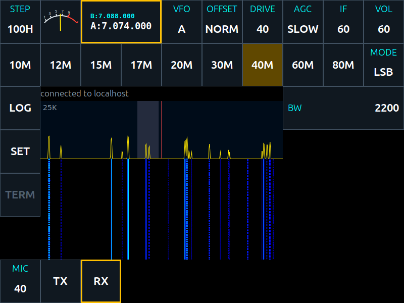
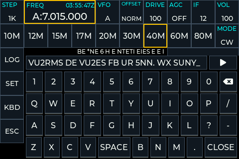
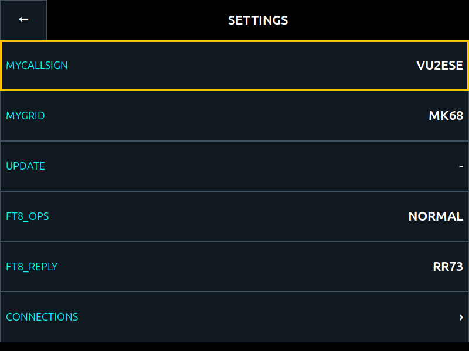
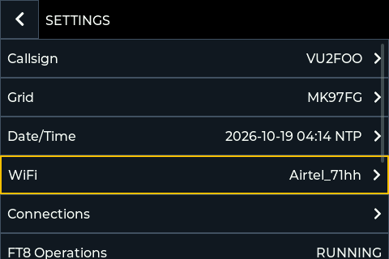

# Welcome, and a quick start

zbitxre is the software for the **zBitx** and the **sBitx v3**, the HF
transceivers from HF Signals. One program, `sdr`, is the radio: it receives,
transmits, keys CW, decodes FT8 and RADE, and keeps the logbook. Everything
you see is a screen onto that one radio:

- on a **zBitx**, the **front panel**, with its touch screen and knob;
- on an **sBitx**, the **local GTK client** on the radio's own screen, with
  the two knobs on its front;
- on another Linux computer, the same GTK client: the **local GTK client**
  on your own network, the **remote GTK client** through my.sbitx.net from
  anywhere;
- in a browser or on a phone, the **web page**, Operate at
  [my.sbitx.net](https://my.sbitx.net), from anywhere.

They all show the same controls, and a change made on one is seen on all of
them at once. So this manual is one manual for both radios. Where the panel
and the GTK client are worked differently, it says how for each.

## What is in this manual

1. **Welcome, and a quick start**: this chapter.
2. [**Mode by mode, and the settings**](02-modes-and-settings.md): USB, LSB, AM,
   CW, FT8, RADE, VOIP and 2TONE, the logbook, SET and CONNECTIONS.
3. [**On line, and operating from afar**](03-online.md): putting the radio
   on my.sbitx.net, operating it from a browser or a phone, the map, VoIP,
   other programs on the radio, and keeping it up to date.
4. [**The controls**](04-controls.md): every control, its values, what it
   starts at, and whether it is remembered.
5. [**The radio's protocol, for clients**](05-protocol.md): for programmers
   who want to write their own screen or script.
6. [**Working on zbitxre with Claude**](06-coding-with-claude.md): how the
   software is made, and how you can change it yourself.

## The screen at a glance

The GTK client and the front panel are laid out alike.

- **Top row:** STEP, the meter, the **frequency** (VFO A large, VFO B small
  above it), then VFO, OFFSET, DRIVE, AGC, IF and VOL.
- **Second row:** the **band** buttons, 10M to 80M, and **MODE**.
- **Left column:** **LOG**, **SET**, and the buttons that belong to the
  mode: KBD and ESC in CW, CQ and HALT in FT8.
- **Middle:** the **spectrum** above and the **waterfall** below, with the
  receiver's passband shaded and your frequency marked by a red line.
- **Right:** the **list** of the controls for the mode in use.
- **Bottom row:** what the mode needs at hand: MIC, TX and RX in the voice
  modes, the CW macros in CW.

The line just above the spectrum is the status line. It says what the radio
has to tell you: that it is connected, that someone is speaking over VoIP,
or why something you asked for was refused.

## This is important : Selecting, turning and pressing

Every list on every screen works the same way:

- **Tappping on the screen** selects a row, and does nothing else;
- **turning the knob** (the panel's knob, the mouse wheel, or the arrow keys) steps
  the selection up and down the list, so that rows off the screen can be
  reached;
- **Pressing on the knob** acts on the selected row: the panel's knob pressed in, the
  middle mouse button, **Enter**, or a second tap on the same row.

A press on a **choice** (such as AGC) moves it to its next value. A press on
a **number** (such as WPM) starts changing it: the row is edged in green,
turning changes the value, and another press or a tap ends it. A press on a
**text** (such as MYCALLSIGN) opens the keyboard.

A row that opens another screen, a keyboard or a question ends in an arrow,
**›**. A row without one changes where it is.

On the front panel, the knob takes **two notches to move one step** in
every list and setting, so that pressing it, which can turn it a notch by
accident, does not move what you selected. Tuning the frequency is the
exception: there every notch is a step.

### The keyboard

Wherever something is typed, the logbook, a callsign, or CW from **KBD**,
the same keyboard comes up: the digits with the rub-out key after 0, the
letters with **SPACE** in the bottom row, a few marks such as `/` `?` `-`
and `.`, and **CLOSE**, which ends the typing. Only typing a WiFi network's
key brings a full keyboard, with small letters, capitals and signs.

#### sBitx Users! ####
- the smaller knob on the top-right changes the selected control on the
main screen directly and its press moves to the next control. In lists (like the logbook) it steps through the rows and its press acts. 
- The larger knob on the bottom-left always tunes.

Anything that restarts the radio or takes it off line asks first, in a box.

## Quick start

### 1. Switch on

The radio program starts with the radio. On an sBitx the local GTK client
opens on the radio's screen, and a terminal beside it shows what the radio
program says. If you close the GTK client, the **zbitxre** icon on the
desktop opens it again.

### 2. Set your callsign

Tap **SET**. Select **MYCALLSIGN**, press, type your callsign on the
keyboard that appears, and tap **CLOSE**. Do the same for **MYGRID**, your
grid locator, such as MK68. The callsign is used by the CW macros, FT8 and
the logbook, and by my.sbitx.net to know your radio.

Tap the arrow at the top left to go back.

### 3. Join your WiFi

For FT8's clock, updates and my.sbitx.net, the radio needs the internet.
In **SET**, select **WiFi** and press. The radio lists the networks it
hears, the strongest first; **SCAN** looks again. Tap yours, type its key,
and tap **JOIN** on the front panel, or **CLOSE** in the GTK client. A
network with no key is joined at once. About ten seconds later the radio
says whether it joined, on the WiFi screen's top line on the front panel
and on the status line in the GTK client, and the WiFi row in SET then
shows the network's name.

WiFi is set only at the radio itself: the GTK client shows the WIFI row
only on the radio's own screen, and the remote GTK client and the web page
never offer it.

### 4. Choose a band and a mode

Tap a **band** button. The radio goes to where you last were on that band.
Tapping the same band again steps through four places the band remembers,
each a frequency and a mode.

Tap **MODE**, or select it and press, to step through the modes: USB, LSB,
CW, CWR, AM, FT8, 2TONE, RADE1, RADE2 and VOIP.

### 5. Tune

Turn the tuning knob, or the mouse wheel over the frequency. **STEP** sets
how far a notch goes: 10 Hz, 100 Hz, 500 Hz, 1 kHz or 10 kHz. A tap on the
spectrum or the waterfall changes how wide a slice of the band they show.

### 6. Listen

**VOL** is the volume. If signals are too strong or too weak in the
waterfall, change **IF**, the gain of the receiver's input. **AGC** sets how
fast the receiver's gain follows the signal.

### 7. Transmit

With an antenna connected:

- **voice:** hold the microphone's PTT, or tap **TX**; tap **RX** to go back
  to receive. **MIC** is the microphone's gain, **DRIVE** the power;
- **CW:** use your key or paddle; see the CW section of the next chapter;
- **FT8:** the radio keys itself in its time slots; see the FT8 section.

The radio goes back to receive by itself after two minutes of continuous
transmission.

### 8. Put it on line

To operate the radio from a browser or a phone, have it on the map, and
talk over the internet, register at
[my.sbitx.net/register](https://my.sbitx.net/register) with the radio
beside you. Chapter 3 shows how. It takes five minutes.

