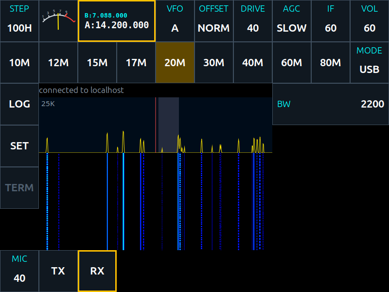
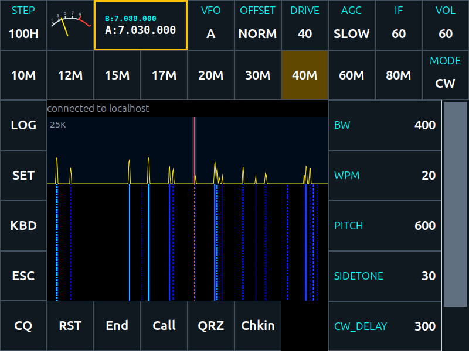
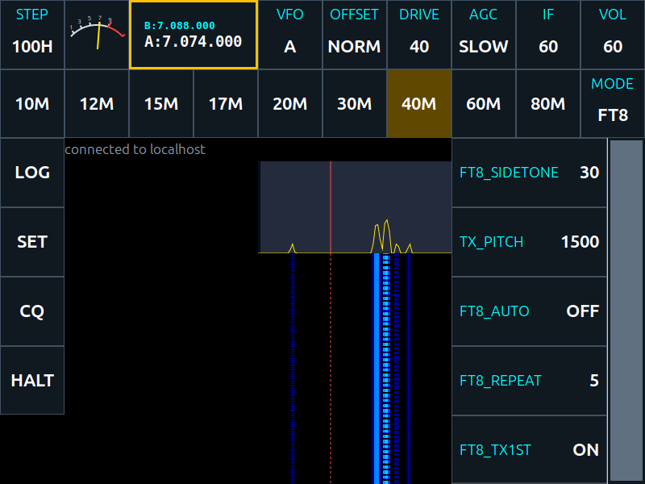
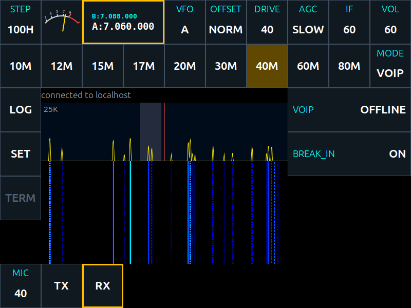
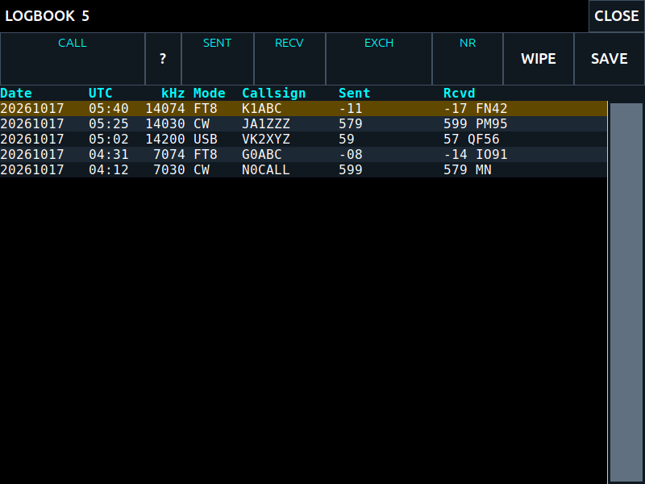
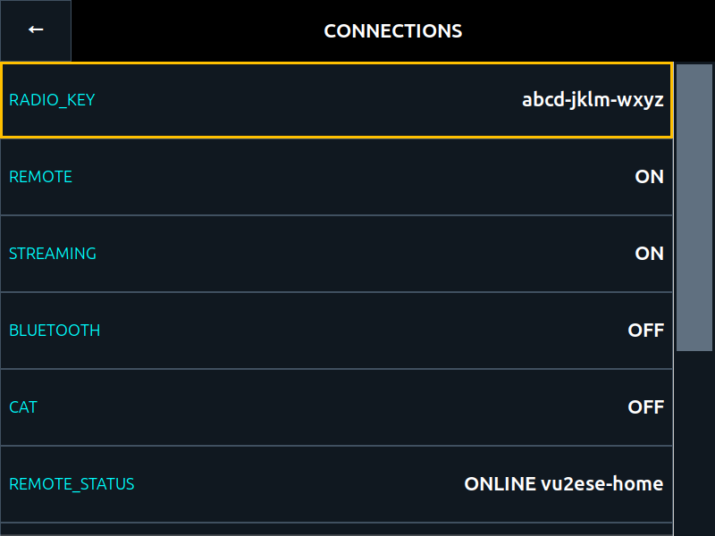

# Mode by mode, and the settings

The list on the right of the main screen changes with the mode: it always
has the radio's own controls, and below them those of the mode in use. The
bottom row changes too. This chapter takes the modes one at a time, then
the logbook, SET and CONNECTIONS. Chapter 4 has every control in full.

Pick a mode with **MODE**: a tap or a press steps it through USB, LSB, CW,
CWR, AM, FT8, 2TONE, RADE1, RADE2 and VOIP. Changing the mode always takes
the radio back to receive first.

## Tuning, in every mode

- **The frequency** is changed by the tuning knob, or by the mouse wheel
  over the frequency, the spectrum or the waterfall. **STEP** sets how far
  a notch goes, and the dial moves onto a multiple of it.
- **VFO** chooses VFO A or B. Each keeps its own frequency. On the panel, a
  press of the knob while the frequency is selected also changes VFO.
- **OFFSET** is NORM, RIT or SPLIT, and is shown in red when it is not NORM.
  At **RIT** tuning moves only the receiver, up to 25 kHz either way, while
  the dial stays. At **SPLIT** the radio receives on VFO A and transmits on
  VFO B. It starts at NORM each time, so the radio never comes up with RIT
  on by surprise.
- **The band buttons** go to where you last were on that band. Tapping the
  band you are on steps through four places it remembers.
- **The spectrum** shows 25, 10, 6 or 2.5 kHz around your frequency; a tap
  on it, or on the waterfall, goes to the next width.

## Voice: USB, LSB and AM



The list has **BW**, the width of what you hear: the low edge stays at
300 Hz and BW moves the top edge, from 300 to 3000 Hz. The bottom row has
**MIC**, the microphone's gain, and **TX** and **RX**.

To talk, hold the microphone's PTT, or tap **TX**; let go, or tap **RX**, to
listen. While the radio transmits, the frequency is shown in red and the
meter shows the power and the SWR.

- **DRIVE** sets the power. The radio scales it for the band, so the same
  DRIVE gives about the same power on every band.
- **MIC** sets how hard your voice drives the transmitter. Raise it until
  the power meter peaks on your speech, and no further.
- **AM** receives only for now; TX is refused in AM.

## CW and CWR



CWR is CW received on the other side of the signal, to step away from
interference.

The list has:

- **BW**, the width of the passband, centred on PITCH;
- **WPM**, the keyer's speed, 5 to 50 words a minute;
- **PITCH**, the tone you hear a signal at, and your sidetone;
- **SIDETONE**, how loud the sidetone is while you send;
- **CW_DELAY**, how long the radio stays in transmit after your last
  element, before it goes back to receive;
- **CW_INPUT**, what is plugged into the key jack: STRAIGHT, IAMBIC
  (iambic A), IAMBICB (iambic B), BUG, or ULTIMATIC.

**Keying.** Plug a straight key or a paddle into the key jack and set
CW_INPUT to match. The radio goes into transmit as you key, and back to
receive CW_DELAY after you stop. You do not touch TX in CW.

**What the radio copies.** CW read off the air is shown on the status line,
the newest at the right. Tune the signal onto the shaded passband and the
radio reads it. It learns the sender's speed from what it hears, within a
span around WPM, so set WPM near the speed you are listening to.

**Macros.** The bottom row has the first six macros: CQ, RST, End, Call,
QRZ and Chkin with the sample file. Tap one to send it. A touch of the
paddle, or a key typed, stops a macro at once. The macros are in the file
`data/cw.mc` on the radio, one to a line:

```
F1 CQ, cq cq cq de {MYCALL} {MYCALL} {MYCALL} ar k
F2 RST, {CALL} de * ur rst {SENTRST} {SENTRST} kn
```

The word before the comma is the button's label. In the text,
`{MYCALL}` (or `*`) is your callsign, `{CALL}` (or `!`) the other station's
from the logbook's CALL field, `{SENTRST}` your report, `{EXCH}` (or `#`) the
exchange, `{GRID}` your grid.

**Typing.** **KBD** in the left column brings up a keyboard on the screen:
each key is sent as you touch it. **ESC** stops what is being sent and drops
what was waiting. A keyboard plugged into the radio sends too, as you type.

## FT8



In FT8 the spectrum and waterfall give way to the **list of messages** the
radio has copied, newest at the bottom: the second each was sent at, its
strength, and its text. Beside it is the graph and waterfall of FT8's part
of the band, with a red line where your own signal will go.

- A station calling **CQ** is in green.
- A message with **your callsign** in it is in yellow, so an answer stands
  out.
- What **your radio sent** is in red.

**Answering a station.** Tap its message to mark it; the list then holds
still. Tap it again, or press the knob, to answer. The radio then carries
the contact through by itself, and logs it at the end. A mark you leave
alone for thirty seconds is taken off.

**Calling CQ.** Tap **CQ** in the left column. **HALT** stops whatever is
being sent and ends the contact without logging it.

**Where you transmit.** Tap a clear place in the graph to move your pitch
there, or set **TX_PITCH**.

The list has:

- **FT8_SIDETONE**, how loud your own transmission is in the speaker;
- **TX_PITCH**, where in the passband you transmit;
- **FT8_AUTO**: ON answers a station that calls you by itself while no
  contact is under way. It starts OFF, so the radio never transmits on its
  own until you say it may;
- **FT8_REPEAT**, how many times a message is sent unanswered before the
  contact is given up;
- **FT8_TX1ST**, which slots your CQ goes in: ON for :00 and :30, OFF for
  :15 and :45.

How you work FT8 is set in SET: **FT8_OPS** is NORMAL, RUNNING (CQ again and
again, and again after each contact) or POUNCING (you only answer the CQs
you mark), and **FT8_REPLY** is what you send at the end, RR73 or RRR.

The radio needs **MYCALLSIGN** set, and the right time, for FT8. Its clock
is set from the network, or from SET on the panel.

## RADE1 and RADE2

RADE is FreeDV's digital voice made with machine learning: speech that
sounds natural down to a low signal to noise ratio. RADE1 is the first
version, RADE2 the second; both ends of a contact must use the same one.

You talk as in USB, with the PTT or **TX** and **RX**, and **MIC** on the
bottom row. The list has **SQUELCH**: ON keeps the speaker silent while no
RADE signal is heard; OFF lets the plain sideband through, which helps when
tuning a station in by ear.

## VOIP



VOIP is talking over the internet, through my.sbitx.net, to every radio
tuned to the same kilohertz as yours: **the dial is the room**. The
transmitter is never keyed in VOIP, and the speaker is silent but for
others speaking. Your radio has to be on line (chapter 3).

The list has:

- **VOIP**: ONLINE puts the radio in the room of its dial. It is kept when
  the radio is switched off, so others can reach you while you are away.
- **BREAK_IN**: ON, as it starts, lets speech over VoIP break in on every
  mode, so you hear the room while you listen to the band. OFF keeps it to
  the mode VOIP alone.

To speak, hold the PTT or tap **TX**: it is **blue** in VOIP, not red, as
your speech goes to the internet and not to the antenna. Who is speaking is
shown on the status line, in any mode, while BREAK_IN is ON.

## 2TONE

2TONE sends two steady tones, 700 Hz and 1900 Hz above the dial, for
testing and measuring the transmitter. Use **TX** and **RX**, and a dummy
load.

## The logbook



**LOG** opens the logbook. The newest entry is at the top.

To log a contact in CW or on the voice, fill in **CALL** (their callsign),
**SENT** and **RECV** (the reports), and if you like **EXCH** (what they
sent you: a serial number, a grid or a name) and **NR** (what you sent).
**SAVE** writes the entry, with the mode, the frequency and the radio's
time. **WIPE** clears the fields. **?** looks up CALL in the logbook, to see
whether you have worked them before.

FT8 logs its contacts by itself.

Tap an entry to select it. Entries can be deleted from the panel's LOG
screen; the search you made stays as it was.

## SET


**SET** opens the station's settings:

- **MYCALLSIGN** and **MYGRID**, your callsign and locator;
- **UPDATE**, which brings the radio up to the newest zbitxre; see
  chapter 3;
- **FT8_OPS** and **FT8_REPLY**, how FT8 is worked;
- **CONNECTIONS**, the next screen.

The panel's SET also has **Date/Time**, to give the radio the time when it
has none from the network, **WiFi**, to join a network, and the panel's
firmware version.

## CONNECTIONS



CONNECTIONS is what the radio has to do with the world outside it:

- **RADIO_KEY**, at the top: the radio's key for my.sbitx.net, twelve
  letters in fours such as `abcd-jklm-wxyz`. You type it at the website
  once, to add the radio. A press asks whether to make a **NEW KEY**, for
  when the old one has gone where it should not; the new key then has to be
  typed in at the website;
- **REMOTE**: ON lets the radio be operated from my.sbitx.net;
- **STREAMING**: ON lets anyone listen to the radio on the map, and see what
  it copies in FT8;
- **BLUETOOTH**: ON plays the radio's sound into a paired Bluetooth
  earphone or speaker;
- **CAT**: ON lets other programs on your network set the frequency and
  mode and key the radio, through Hamlib's NET rigctl.

Under the switches are what the radio has to say of each, which can be read
but not changed: **REMOTE_STATUS** (ONLINE and the radio's name when all is
well), **VOIP_STATUS**, **BLUETOOTH_STATUS**, **SOUND_CARD_STATUS** and
**CAT_STATUS**.

REMOTE and STREAMING start ON on a new radio. CONNECTIONS is set at the
radio only: a window operating the radio from afar does not show it.
