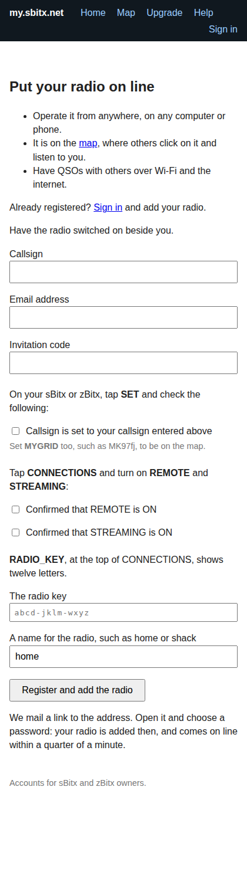
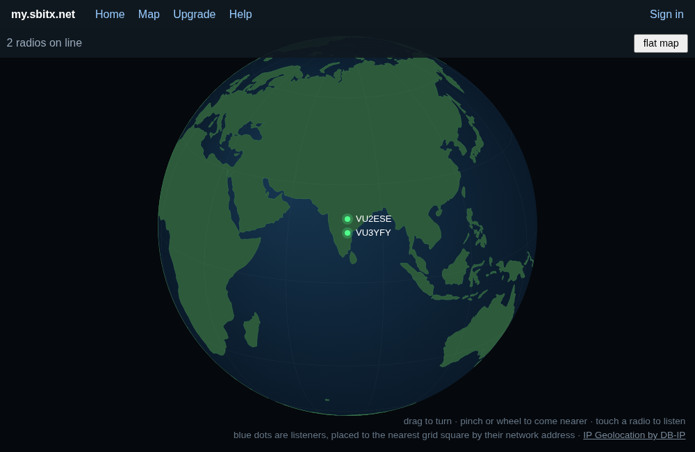
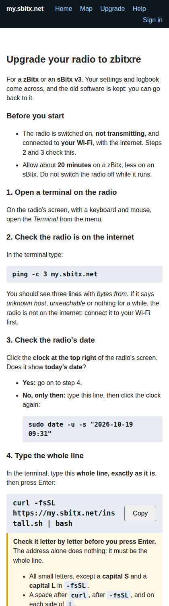

# On line, and operating from afar

Put your radio on [my.sbitx.net](https://my.sbitx.net), and:

- **operate it from anywhere**, in a browser on any computer or phone;
- **it is on the map**, where others click on it and listen to you;
- **have QSOs over the internet**, VoIP, with other radios tuned where yours
  is.

The radio needs the internet, through your WiFi (on an sBitx, a network
cable will do). Nothing has to be opened on your router: the radio makes
the connection out to my.sbitx.net and keeps it.

## Registering, and adding your radio

One form does both. Have the radio switched on beside you, and open
[my.sbitx.net/register](https://my.sbitx.net/register).

1. Give your **callsign** and **email address**, and the **invitation code**
   while registration is by invitation.
2. On the radio, tap **SET**: check **MYCALLSIGN** is your callsign, and set
   **MYGRID** too, to be placed on the map. Tick **Callsign is set to your
   callsign entered above**.
3. Tap **CONNECTIONS**, and turn on **REMOTE** and **STREAMING**. Tick the
   two boxes that say so.
4. **RADIO_KEY**, at the top of CONNECTIONS, shows twelve letters. Type
   them into **The radio key**. Give the radio a name, such as home or
   shack; `home` is filled in.
5. Press **Register and add the radio**. The button says "One moment..." for
   a second or two first, while the browser does a little work that keeps
   spammers out.

A link is mailed to you. Open it and **choose a password**. Your radio is
added then, and you are signed in. Your page waits for the radio, looking
again every five seconds, and within a quarter of a minute it is on line,
as `vu2ese-home`, with **Operate** beside it.

**Why the three boxes.** The radio signs in with the callsign set on it and
its key. A radio whose MYCALLSIGN is not the callsign you registered, or
whose REMOTE is off, never comes on line; one with STREAMING off is not on
the map.

**If the radio does not come.** After two minutes the page says what to
check. On the radio, in SET then CONNECTIONS: **REMOTE** ON, and
**REMOTE_STATUS** should say ONLINE. If it says ADD RADIO_KEY AT
MY.SBITX.NET, the site does not have this radio's key: add it, or type the
key on the radio's **Manage** page. If it says SET MYCALLSIGN FIRST, set it.

**Already registered?** Sign in, and use **Add Radio**: the same three boxes,
the key and a name. An account has room for five radios.

**"That radio key is already in use".** No two radios at my.sbitx.net may
have the same key. If yours is refused, on the radio tap **RADIO_KEY**,
choose **NEW KEY**, and type the new twelve letters. A key seen twice is a
copied memory card, or a radio sold without being removed from its old
owner's account.

**Selling or giving away a radio.** On its **Manage** page, **Remove** it.
The new owner makes a new key and adds it to their own account.

**Making a new key.** If a copy of the radio's card has gone where it should
not, tap **RADIO_KEY**, choose **NEW KEY**, and type the new letters on the
radio's **Manage** page. Anything signed in with the old key is let go within
twenty seconds.

## Operating from a browser or a phone

On your page at my.sbitx.net, press **Operate** beside the radio. The page
has the frequency, the bands, the mode, the spectrum and waterfall, and the
same list of controls as the radio, and it plays the radio's sound. Speak
with the PTT on the page, in the modes that are spoken into.

**Install it as an app** on a phone, from the Operate page:

- **Android, Chrome:** the menu, then *Install app*;
- **iPhone, Safari:** Share, then *Add to Home Screen*;
- **a computer, Chrome or Edge:** the install icon at the right of the
  address bar.

It opens full screen and on its side. Tick **Remember me** when you sign in
on the phone, so that the app stays signed in.

CONNECTIONS cannot be changed from afar: REMOTE, STREAMING and the key are
set at the radio only.

## The GTK client on another computer

The same GTK client as on the sBitx's screen runs on a Linux desktop.

- **At home, on the same network as the radio:**
  `zbitx_gui 192.168.1.82`, with the radio's address.
- **From anywhere, through my.sbitx.net:**
  `zbitx_gui remote vu2ese-home`, with your radio's name. The first time it
  asks for the password you sign in to the website with. Changing that
  password signs it out everywhere, which is what to do if a laptop is
  lost.

## The map

[my.sbitx.net/map](https://my.sbitx.net/map) shows the radios that are on
line and streaming. Anyone may use it, without an account: click a radio to
listen to it, and see what it copies in FT8. **flat map** shows the world
flat instead of as a globe. Your radio is placed by its **MYGRID**, and
only its callsign and grid square are shown.

## Talking over the internet: VoIP

With the radio on line, set **VOIP** to ONLINE in the mode VOIP's list. You
are then in the room of your dial, rounded to the kilohertz: everyone else
on that kilohertz hears you, and you hear them. Chapter 2 has the details,
and **BREAK_IN**, which decides whether the room is heard in the other modes
too. **VOIP_STATUS** on CONNECTIONS says which room you are in and how many
are there, such as `7074 KHZ, 3 HERE`.

## Other programs on the radio

- **Sound for WSJT-X, FreeDV and the like.** The radio always offers two
  sound devices to other programs, one to hear the receiver by and one to
  send by. **SOUND_CARD_STATUS** on CONNECTIONS gives their names; choose
  them in the other program.
- **CAT.** Turn **CAT** ON, and other programs can set the frequency and
  mode and key the radio, through Hamlib's NET rigctl. **CAT_STATUS** says
  the address and port to give them.
- **Bluetooth.** Pair an earphone or speaker from the desktop's Bluetooth
  menu, then turn **BLUETOOTH** ON to play the radio's sound into it.

## Keeping the radio up to date

**From the radio.** In SET, select **UPDATE** and press. A box asks first;
say yes. A view of the update, on the front panel and in the GTK client,
shows each step as it happens: asking GitHub for news, building (about ten
minutes on a zBitx, less on an sBitx), building the GTK client, then
restarting the radio. **CANCEL** in the view stops it, and the radio is left
as it was.

When something new was built, the radio waits until it is not
transmitting, then restarts itself with the new version. On a zBitx it then
gives the front panel its new firmware, if there is one, which takes under
a minute; the panel restarts with its coloured bars, as it does when
switched on. The last step says what the radio and the panel now have, such
as `DONE: now 4935493; panel 3a0386b, as before`. If there was nothing new,
it says `DONE: already up to date`.

On success the view **closes by itself** three seconds later, on the front
panel and in the GTK client, and the GTK client starts again as its new
build. A zBitx needs no monitor, so nothing waits for you to press anything.
If the update failed or was cancelled, the view stays open, so that you can
read why, until you press **CLOSE**.

Your settings, your logbook and the radio's calibration are never touched
by an update.

**The first time.** A radio still on the old software is moved to zbitxre
once, from a terminal on the radio's screen, as
[my.sbitx.net/upgrade](https://my.sbitx.net/upgrade) shows step by step.
The old software is kept, and `~/zbitxre/setup/undo_install.sh` puts it
back.

- On a zBitx, the install turns off the radio's own WiFi access point,
  which many zBitxes came with for the old software. A zBitx running
  zbitxre is a WiFi client only: the access point beside the client loses
  much of what the radio sends and receives. `undo_install.sh` turns it
  back on.
- On a zBitx whose front panel has the old firmware, the terminal says the
  front panel needs the USB cable. That is done once, as the Upgrade page
  shows: radio off, the panel's USB cable unplugged, the tuning knob held in
  while the radio is switched on, then the cable to a computer and
  `front_panel.uf2` copied onto the drive that appears. After that, every
  update gives the panel its firmware by itself.

## When something is wrong

- **The radio is off line.** On the radio, SET then CONNECTIONS: REMOTE ON,
  and REMOTE_STATUS saying ONLINE. The radio needs the internet; check its
  WiFi.
- **The date is wrong**, as a radio that has been off the internet can
  think it is the year 2000. Secure connections then fail, with "SSL
  certificate problem". Click the clock at the top right of the radio's
  screen to see the date. The Upgrade page gives the line that sets it.
- **You hear nobody on VoIP.** Both radios must be on the same kilohertz,
  with VOIP ONLINE. In another mode than VOIP you hear the room only with
  BREAK_IN ON.
- **The GTK client was closed.** Click the **zbitxre** icon on the radio's
  desktop. It opens the GTK client, and starts the radio program too if
  that is not running.
- **The radio is not on the internet**, on a zBitx still on the old
  software: its own WiFi access point may be in the way. The install turns
  it off; until then, the WiFi can come and go.
